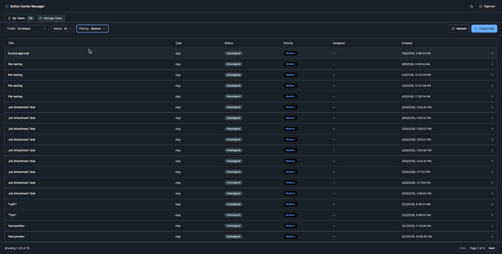

# Action Center Manager — UiPath Coded Web App sample

A minimal React + TypeScript [UiPath Coded Web App](https://docs.uipath.com/)
demonstrating the `@uipath/uipath-typescript` SDK's **Tasks (Action Center)**
service. It's an operational dashboard for triaging human tasks: list and
filter them across your folders, view detail, assign / reassign / unassign,
complete them through a **form rendered from the task's own schema** (or the
embedded Action Center task), and create external tasks. **Document Validation
tasks** open the
[`@uipath/ui-widgets-validation-station`](https://github.com/UiPath/uipath-ui-widgets/pkgs/npm/ui-widgets-validation-station)
widget so a reviewer can validate the extracted document data inline.

Built on UiPath's [Apollo Vertex](https://apollo-vertex.vercel.app/) design
system via [`@uipath/apollo-wind`](https://www.npmjs.com/package/@uipath/apollo-wind).

## Preview



## What it demonstrates

The task-centric methods on [`TaskServiceModel`](https://uipath.github.io/uipath-typescript/api/interfaces/TaskServiceModel/):

| SDK call | Where |
|----------|-------|
| `Tasks.getAll({ folderId, pageSize, jumpToPage, filter, orderby, asTaskAdmin })` | `hooks/useTasks.ts` (`useTasks`) — paginated, filterable list |
| `Tasks.getById(id, {}, folderId)` | `hooks/useTasks.ts` (`useTask`) — full detail |
| `Tasks.getDataById(id, { folderId })` | `taskSchema.ts` — Quick Form task values |
| `Tasks.saveData(id, data, { folderId, type })` | `taskSchema.ts` (`saveTaskDraft`) — **Save draft** in the form |
| `Tasks.getUsers(folderId)` | `hooks/useTasks.ts` (`useTaskUsers`) — assignee picker (cursor-looped) |
| `Tasks.create({ title, priority }, folderId)` | `components/TaskList.tsx` (create form) |
| `task.assign` / `task.reassign` / `task.unassign` | `components/TaskDetail.tsx` |
| `task.complete(options)` | `components/TaskDetail.tsx` — outcome buttons in the Form tab and the free-text fallback, both via `taskSchema.ts` `buildCompletion` |
| `Tasks.getById(id, { taskType: TaskType.DocumentValidation }, folderId)` + `task.complete({ type: TaskType.DocumentValidation, … })` | `components/DocumentValidationDialog.tsx` — loads the validation payload and submits it |

By default the app lists tasks across **all folders** you can view/edit. The
toolbar's **Folder** dropdown (populated by `Folders.getAll`) lets you scope
the list to one folder; the choice is persisted to `localStorage`. Per-task
actions (assign, complete) use each task's own folder, propagated from the
row; creating a task picks the target folder from the same dropdown.

## Files

```
src/
  main.tsx            App.tsx            index.css
  taskUtils.ts        — badges, filter builder, complete-options builder, formatting
  taskSchema.ts       — task schema (`task.getSchema()`) normalization for App tasks and Quick Forms, completion helper
  taskUrl.ts          — Action Center task / embed URL construction
  context/AuthContext.tsx — OAuth/PKCE via the SDK (Coded Apps template)
  hooks/useTasks.ts   — useTasks + useTask + useTaskUsers + useFolders
  components/Theme.tsx, SignIn.tsx, TaskList.tsx, TaskDetail.tsx
  components/FolderPicker.tsx, AssigneeFilter.tsx, FilterSelect.tsx — list toolbar filters
  components/BulkActions.tsx — bulk assign / reassign / unassign on Manage Tasks
  components/CreateForm.tsx — create-task dialog
  components/TaskTableSkeleton.tsx — loading placeholder for the table
  components/TaskForm.tsx — schema-driven form renderer (inputs read-only, inOuts/outputs editable, outcomes)
  components/DocumentValidationDialog.tsx — validation-station host for Document Validation tasks
```

## Prerequisites

- Node.js 20+
- A UiPath OAuth External Application (client ID) with **`OR.Tasks`**,
  **`OR.Folders.Read`**, **`OR.Buckets`**, and **`Apps.Read`** scopes.
  `OR.Folders.Read` powers the folder dropdown (`Folders.getAll`); `OR.Buckets`
  lets the validation-station widget fetch the document binary referenced by a
  Document Validation task; `Apps.Read` is needed to read an action app's
  schema (see *Rendering tasks* below). Grant the
  scopes on the External Application in Admin **and** list them in `uipath.json`.
- An Orchestrator folder that contains Action Center tasks (only needed for
  testing — leaving the filter on "All folders" still works)

## Setup

```bash
npm install
cp uipath.json.example uipath.json   # then fill in your values
npm run dev                          # http://localhost:5173
```

`uipath.json` (git-ignored) configures local dev — the `@uipath/coded-apps-dev`
Vite plugin reads it and injects the `<meta name="uipath:*">` tags the SDK
needs. A deployed Coded App gets these from the platform, so the same code works
in both places.

## Build & deploy

```bash
npm run build      # tsc && vite build → dist/

uip codedapp pack dist -n action-center-app --version 1.0.0
uip codedapp publish
uip codedapp deploy -n action-center-app --folder-key <FOLDER_KEY>
```

## Notes

- **My Tasks vs Manage Tasks:** these map to `getAll`'s `asTaskAdmin` flag.
  - **My Tasks** — clicking a row opens the task sheet on its **Form** tab, the
    daily worker view: the task rendered from its schema with one button per
    outcome. A **Document Validation** task instead opens the validation-station
    widget (see below).
  - **Manage Tasks** (`asTaskAdmin: true`) — clicking rows selects them
    (multi-select), and bulk **Assign** / **Unassign** appear in the
    toolbar. Surfaces `Tasks.assign(payload[])` and `Tasks.unassign(ids)`
    in their array forms. When status is filtered to *Pending*, an
    additional **Assigned to** filter (powered by `Tasks.getUsers`) lets
    an admin see who's overloaded.
- **Pagination:** the list uses server-side page navigation (`jumpToPage` +
  `totalCount`); the user picker loops the cursor. No list call assumes one
  response holds every row.
- **Creation** through the API only supports **external** tasks — form and
  app tasks are created by the system through workflows.
- **Rendering tasks:** the task sheet (`components/TaskDetail.tsx`) has three tabs.
  **Form** (default) is a native form built from the task's schema by
  `components/TaskForm.tsx`: inputs read-only, inOuts/outputs editable with a
  widget per type, and one button per outcome; submitting calls
  `task.complete({ type, action: <outcome>, data })`, **Save draft** calls
  `task.saveData(data)`. **Details** is Action Center's task summary. **Action
  Center** embeds the task itself (`/embed_/{org}/{tenant}/actions_/current-task/tasks/{id}`,
  built by `taskUrl.ts`) for the exact experience the app designer built.

  Where the schema comes from (`taskSchema.ts`): `task.getSchema()` (or
  `tasks.getSchema(taskId, { folderId })`) returns it, and its `type` says
  which shape it has.

  | Task type | Schema | Values |
  |-----------|--------|--------|
  | **App task** (coded or low-code action app) | `inputs`, `outputs`, `inOuts` and `outcomes`, each property typed with a .NET name (`String`, `Int32`, `Decimal`, `DateTime`, `DataTable`, `File`, …) | `task.data` |
  | **Quick Form** (Maestro/Flow HITL node) | the body the form was registered with: `fields[]` + `outcomes[]` | `task.data` |
  | External / legacy Form / Document Validation | none, `getSchema()` resolves to `null`. The Form tab shows `data` as stored and **Complete** takes a free-text action | `task.data` |

  Two things to know about the app-task schema:

  - **`Apps.Read` is required.** An App task's schema is returned only when
    the token has the `Apps` or `Apps.Read` scope and the signed-in user can
    view apps in the task's folder. Without them the call still succeeds but
    the schema has no fields and no outcomes, and the sheet says so before
    falling back to the raw values.
  - **A property's `name` is its data key.** The schema also carries a `key`,
    but that is a UUID the Apps designer generates per property and it never
    appears in the task's `data`. Outcomes work the same way: the `name`
    (e.g. `Approve`) is the action string you complete the task with.
- **Document Validation:** selecting a task of type `DocumentValidationTask`
  (from a My Tasks row, or via **Validate document** in the detail sheet) opens
  a near-fullscreen dialog hosting `@uipath/ui-widgets-validation-station`. The
  widget renders the source document next to the extracted fields; **Save**
  validates and keeps the task open, **Submit** validates then completes it via
  `task.complete({ type: TaskType.DocumentValidation, action: 'Completed' })`.
  `vite.config.ts` copies the widget's `du-assets` (PDF renderer + translations)
  into the production bundle so document rendering works after deploy.
