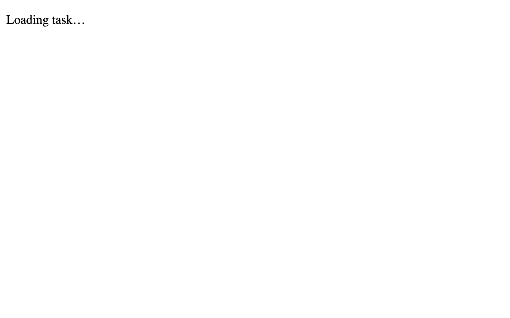

# Coded Action App Starter

A bare starting point for a UiPath **Coded Action App**: React, Vite and TypeScript, with the
[`@uipath/coded-action-app`](https://www.npmjs.com/package/@uipath/coded-action-app) and
[`@uipath/uipath-typescript`](https://www.npmjs.com/package/@uipath/uipath-typescript) SDKs installed and
nothing else. Start from `src/App.tsx`.

What is already wired up:

- `src/uipath.ts` creates the `CodedActionApp` service that talks to Action Center.
- `src/App.tsx` loads the task with `getTask()` and shows its title. Outside Action Center there is no task to
  load, so the page says to open it from a task instead.
- `action-schema.json` declares one input, one output and a `Done` outcome as a shape to copy.
- `vite.config.ts` sets `base: './'`, so assets resolve under the `<base href>` Action Center injects.

## Preview



---

## Pre-requisites

- **Node.js** 20.19+ or 22.12+ (Vite 8)
- **npm** 8.x or later
- A **UiPath Automation Cloud** tenant
- The [UiPath CLI](https://uipath.github.io/uipath-typescript/coded-action-apps/cli-reference/#installation)

  ```bash
  npm i -g @uipath/cli
  ```

An External Application (OAuth client) is needed only once the app calls other UiPath services, such as
Orchestrator or Data Fabric. Reading and completing the task does not need one.

---

## Setup

### 1. Install dependencies

```bash
npm install
```

### 2. Configure `uipath.json` (only if the app calls UiPath services)

Copy `uipath.json.example` to `uipath.json` and fill in the `clientId` of your External Application and the
scopes the app calls. See [Configure `uipath.json`](https://uipath.github.io/uipath-typescript/coded-action-apps/getting-started/#configure-uipathjson).
When the starter becomes your app, remove `uipath.json` from `.gitignore`: it holds no secrets, and
`uip codedapp pack` and CI read it.

### 3. Run it locally

```bash
npm run dev
```

Then open the Action Center Coded Action App Debug page,
`https://cloud.uipath.com/<orgName>/<tenantName>/actions_/debug/coded-action-app` (org and tenant by
**name**), fill in the details and load `http://localhost:5173`. The page simulates a task for the app.
Once the app calls UiPath services, also install `@uipath/coded-apps-dev` and follow
[Set Up Local Development](https://uipath.github.io/uipath-typescript/coded-action-apps/getting-started/#set-up-local-development-optional).

### 4. Deploy to UiPath Cloud

```bash
uip login
npm run build
uip codedapp pack dist -n <app-name> --version 1.0.0
uip codedapp publish --type Action
uip codedapp deploy
```

`<app-name>` becomes the app's URL path, which is unique within your organization.

---

## Action Schema

`action-schema.json` defines the data Action Center passes in and expects back. Replace the placeholders
with your own fields.

### Inputs

| Field | Type | Description |
|---|---|---|
| `input1` | string | Placeholder input |

### Outputs

| Field | Type | Description |
|---|---|---|
| `output1` | string | Placeholder output |

### Outcomes

| Outcome | Triggered by |
|---|---|
| `Done` | `codedActionApp.completeTask('Done', data)` |
