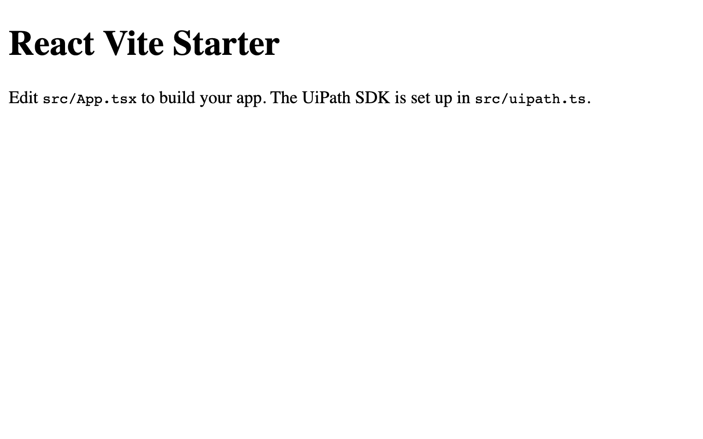

# React + Vite Starter

A bare starting point for a UiPath **Coded App**: React, Vite and TypeScript, with the
[`@uipath/uipath-typescript`](https://www.npmjs.com/package/@uipath/uipath-typescript) SDK installed and
nothing else. There are no prebuilt features to strip out — start from `src/App.tsx`.

What is already wired up:

- `vite.config.ts` sets `base: './'`, so assets resolve under the `<base href>` the platform injects at deploy
  time, and loads the `@uipath/coded-apps-dev` plugin, which hands `uipath.json` to the SDK.
- `src/uipath.ts` creates the SDK instance. It reads its configuration from the platform, so it takes no
  arguments. Signing in is left to you: call `await sdk.initialize()` from a user action such as a
  **Sign in** button. It redirects to the UiPath sign-in page, so when the page loads again, finish signing in
  with `if (sdk.isInOAuthCallback()) await sdk.completeOAuth()`.

## Preview



## Run it locally

Requires Node.js 20.19+ or 22.12+ (Vite 8).

1. Copy `uipath.json.example` to `uipath.json`. The dev server won't serve the page without it.
2. Install and start:

   ```bash
   npm install
   npm run dev
   ```

3. When the app starts calling UiPath services, create an **external application** (non-confidential,
   user-mode) in UiPath Admin with redirect URI `http://localhost:5173` and only the scopes your app calls,
   then fill in `clientId`, `scope`, `orgName` and `tenantName` in `uipath.json`.

When the starter becomes your app, remove `uipath.json` from `.gitignore`: it holds no secrets, and
`uip codedapp pack` and CI read it.

## Deploying as a Coded App

```bash
# One-time: install the codedapp tool plugin for the uip CLI.
uip tools install codedapp

npm run build
uip login --interactive
uip codedapp pack ./dist --name <app-name> --version <version>
uip codedapp publish --name <app-name> --version <version> --type Web
uip codedapp deploy --name <app-name> --folder-key <folderKey>
```

`<app-name>` becomes the app's URL path, which is unique within your organization.
See the [Coded Apps CLI reference](https://uipath.github.io/uipath-typescript/coded-apps/cli-reference/) for
all options.
